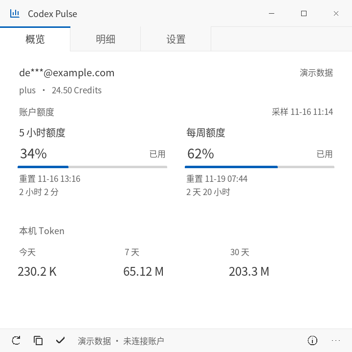

# Codex Pulse 1.0.7

1.0.6 更新界面：浅灰背景、白色圆角分组、淡蓝渐变工作台，以及带蓝色下划线的文字导航。额度采用双列卡片，本机 Token 使用嵌套浅灰卡片，账户与订阅信息收纳于工作台。托盘使用细边框竖向进度条表示剩余额度：正常白色，低于 20% 橙色，低于 10% 红色。首次正常运行默认开启自启动。默认页面无需滚动，长列表分页。更新前，请从托盘菜单完全退出旧进程，再替换 EXE；设置保留。详见 `CHANGELOG.md`。

一个轻量、原生、中文界面的 Windows Codex 用量工具。**只需要 `CodexPulse.exe` 即可运行**，无需安装 Python、Node.js、.NET、Java、WebView2 或 VC++ Redistributable。

面向 **Windows 10 1703 及以上 / Windows 11，x64**。ARM64 Windows 11 可尝试系统的 x64 模拟，未验证；不提供 32 位版本。

## 下载

前往 [GitHub Releases](https://github.com/brianuuuu/codex-pulse/releases/latest)，下载 **CodexPulse-v1.0.7-windows-x64.zip**，解压后双击 `CodexPulse.exe`。Release 附带 SHA-256 校验文件；GitHub 自动生成的 Source code 下载项只包含源码。

## 源码仓库

当前仓库对应 **1.0.7**，包含紧凑界面、融合标题栏、细边框竖向托盘进度条、低额度变色和默认自启动功能。1.0.7 仅保留一份标准 MIT `LICENSE`。可执行文件在 Release 中发布，构建缓存不提交到 Git。

在 Windows 上克隆到你的开发目录：

```powershell
git clone https://github.com/brianuuuu/codex-pulse.git D:\code\ai\codex-pulse
cd D:\code\ai\codex-pulse
```

安装 MinGW-w64 GCC 并将 `g++`、`windres` 加入 PATH 后，运行 `build.bat`。输出为 `dist/CodexPulse.exe`。运行编译好的 EXE 无需上述编译工具。



## 开始使用

1. 解压下载的 ZIP，双击根目录下的 `CodexPulse.exe`。
2. 在 Codex 客户端或 CLI 中，用 **ChatGPT 账户**登录。已有登录信息时，无须再次向本工具输入密码或 Token。
3. 工具优先使用 `CODEX_HOME` 环境变量，否则读取 `%USERPROFILE%\.codex`。目录不一致时，点击右上角设置图标，再点击文件夹图标，指定包含 `auth.json` / `sessions` 的 Codex 数据目录。
4. 默认每 **2 分钟**刷新一次。点击左下角刷新图标或按 **F5** 可立即刷新。

EXE 可单独复制到任意普通用户可写的文件夹运行。程序无安装步骤、无需管理员权限。源码、说明和截图不影响 EXE 独立运行。仓库克隆后需编译；发行 ZIP 可直接运行其中的 EXE。

## 任务栏与托盘

- 窗口打开时有普通任务栏按钮，支持调整大小。标题栏与内容使用同一表面；拖动品牌或顶部空白处可移动窗口，双击可最大化/还原，右侧为最小化、最大化/还原、关闭按钮。
- 默认最小化或点击关闭后，常驻底部任务栏右侧的**通知区域 / 系统托盘**。
- **双击托盘图标**打开详情小窗口；右键可刷新、复制报告、打开用量网页和退出。
- 托盘使用**细边框竖向进度条**，无数字、无实心底块。填充表示已返回额度窗口中**最少的剩余比例**，从底部向上填充：剩余越多，填充越高；完全用尽时保留空轮廓；暂不可用时显示三个竖排小点，避免与额度用尽混淆。悬停显示一位小数的「最少剩余」、对应额度名称、主要额度已用比例和数据来源。
- 剩余额度 **≥ 20% 为白色，10%–不足 20% 为橙色，不足 10% 为红色**；边框和填充同步变色。恰好 20% 仍是白色，恰好 10% 仍是橙色。无数据保持白色三点，不触发低额度颜色。
- 进度条按通知区域实际 DPI 对齐像素绘制，宽高约为 5:8，保留完整高度；16 / 20 像素图标的竖条分别为 10 × 16 / 12 × 20 像素，使用不透明的 1 像素边框，更大图标按 DPI 缩放。填充保留原始小数比例，不向上取整、不强制至少 1 像素，仅填充顶端一行以透明度表达不足一像素的部分。小图标可用高度有限，具体百分比请看悬停提示。窗口和程序文件仍使用蓝色品牌图标。
- 在设置中关闭「最小化到托盘」，可让最小化后的窗口保留在普通任务栏。点击关闭仍会驻留托盘。
- Windows 可能将图标放在 `^` 的隐藏图标区域，可在系统任务栏设置中设为始终显示。
- 完全退出：右键托盘 →「退出 Codex Pulse」，或 **Ctrl+Q**。

## 显示内容

**概览**

- 主要额度、周期额度：已使用比例、重置时间和剩余时长。剩余比例在托盘悬停提示和复制报告中查看。
- 常见的 5 小时 / 每周窗口按服务实际返回的窗口长度显示；不虚构固定额度上限。
- 接口返回时，还可显示模型附加额度、代码审查额度、订阅计划及额外 Credits。
- 账户邮箱局部遮盖，显示订阅、Credits 和采样时间。缓存、本地快照等关键状态保留简短标记，来源与连接详情可点击底部状态图标查看。
- 今日、近 7 天、近 30 天的本机 Token。

**明细**

- 近 7 天每日 Token 柱状图。
- 今日输入、缓存输入、输出、推理输出与总计。
- 近 30 天模型分布，最近最多 40 个会话；点击明细页右上角三个子图标切换趋势、模型和会话。列表自适应分页，页尾箭头翻页。
- 已扫描文件数、会话数；存在异常或分批扫描时才显示相应提示。详细状态可点击底部状态图标查看。
- 一键复制可阅读的用量报告，不包含登录 Token、会话正文或文件路径。

**设置**

- 跟随系统 / 浅色 / 深色主题。
- 1、2、5、15 分钟刷新，点击按钮依次切换。
- 在线额度开关；关闭后只读取本地数据。
- 最小化方式、90% 额度提醒、开机启动（默认开启，可手动关闭）。
- 自定义 Codex 数据目录与恢复自动检测。

## 自启动

- 首次正常运行新版时，默认注册当前 Windows 用户的自启动，无需管理员权限。登录 Windows 后以 `--tray` 模式驻留托盘，不弹出主窗口。
- 设置页的电源图标可开关自启动。手动关闭后保存选择，后续启动不会自动重新开启。
- 从 1.0.3 或更早版本升级时，旧设置尚未记录此选项，因此首次运行 1.0.4 或更高版本会应用一次默认开启。主题、目录等其他设置保留。
- 自启动指向当前 EXE 路径。请先把 EXE 放到准备长期使用的文件夹；移动后可关闭再开启自启动来更新路径。
- 演示模式只模拟开关，不注册自启动，也不保存设置。Windows 启动应用管理或组织策略可独立限制启动。

## 界面与操作

- 浅灰页面底色、白色无描边圆角分组、浅灰内卡片与蓝色强调色；工作台使用全不透明淡蓝渐变。深色主题同步采用对应的深色表面。内容通过留白、对齐和底色分组，保留额度进度条和键盘焦点提示。
- 默认窗口为 480 × 520 DIP，品牌标题为 14 DIP，压缩卡片、分组与工具栏留白。白色标题栏下方排列「概览 / 明细 / 设置」文字导航，以蓝色短下划线标记当前页面；底部为白色操作栏。页面出现滚动条时也保持相同的卡片和导航宽度。
- 概览工作台显示本地日期、连接状态、账户及订阅 / Credits；额度双列展示，重置时间与剩余时长分别成行，采样时间位于额度组右上方。
- 工具操作显示图标；鼠标悬停可看中文名称和快捷键，原生按钮保留可访问名称；键盘焦点通过底色或短下划线提示，不显示边框。
- 正常尺寸下常用页面无滚动条。额外额度很多、窗口被缩得很小等内容确实溢出的情况，才出现滚动条，保证信息完整。
- 右下角信息图标打开版本与说明，省去主界面常驻的解释文字。
- 父窗口和按钮分别双缓冲，倒计时按分钟局部更新，图标数据未变时不重复提交，减少闪烁。

## 数据口径：请先了解这几点

1. **账户额度**来自 ChatGPT 的 `https://chatgpt.com/backend-api/wham/usage`。它反映服务端的账户额度；并不是用本地 Token 换算的百分比。
2. **本机 Token**来自所选 Codex 目录中的 `sessions` 与 `archived_sessions` JSONL。它只覆盖本机已保存的记录，不代表其他电脑或云端的全部消耗，也不等于账单费用。
3. 输入 Token **已包含缓存输入**；输出 Token **已包含推理输出**。子项不会再次相加。每天按 **Windows 系统本地时区**统计，近 7 / 30 天包含今天。
4. 使用累计快照增量统计，去除重复或倒序快照；按会话 ID 去除会话文件重复；已标记的分叉会话从首条新增用量开始。只存在 `last_token_usage`、却没有累计计数的记录无法可靠去重，因此不纳入统计。
5. 扫描最近 31 天有文件更新的日志，再汇总其中最近 30 个日历日的数据。旧会话的新记录也能计入。界面中「最近会话」的数字是**该会话日志的累计**，模型分布是近 30 天。
6. API Key 或第三方 API 模式没有 ChatGPT 订阅额度。此时仍能显示本地 Token，但不会伪造剩余额度、费用或使用率。
7. 离线时，优先保留**同一账户、当前进程内**最近一次在线额度；否则显示本地日志中的最新额度快照，并明确标为「本地快照 · 可能已过期」。本地额度快照可能属于此前使用的账户，仅作历史参考。重置时间经过后，不会自行将用量归零。
8. 未识别、缺失的字段显示「未提供」；损坏行被跳过并计数。日志缺失、只剩半条记录或不同版本的记录格式会使统计不完整。

## 登录、连接与隐私

- 支持 Codex `auth.json` 内的 `tokens.access_token`、账户 ID，以及 Codex 传统 Windows 凭据管理器（direct keyring）存储。
- **新的加密 secrets 存储、仅保存在客户端进程中的凭据、WSL 内部登录及自定义认证代理未实现直接读取**。这类情况仍可使用本地日志；需要在线额度时，可使用独立的 Codex CLI 登录目录，并在工具中选择该目录。不要为本工具降低现有凭据的保护方式。
- 登录过期时，在 Codex 中重新登录，然后刷新。工具**不刷新、不修改、不保存 OAuth Token**，避免与 Codex 的令牌轮换互相干扰。
- HTTPS 仅访问固定的 `chatgpt.com`，启用证书校验、禁用重定向，使用 Windows 系统代理。若代理软件仅设置了命令行 `HTTP_PROXY` 而未设置系统代理，本工具不会自动继承该配置。
- 无遥测、无自动更新、无后台会话上传。只读用量相关数据，内存中不保存对话正文。复制报告也不带认证信息。
- 仅把偏好设置写入 `%LOCALAPPDATA%\CodexPulse\settings.json`，不持久化 Token 或用量历史。首次正常运行默认启用、或手动开启自启动时，会写入当前用户的 `HKCU\Software\Microsoft\Windows\CurrentVersion\Run\CodexPulse`。
- 401 / 403 / 429 / 网络失败会显示对应状态；自动刷新遇到失败会退避。长日志分批读取，每轮数据读取上限 64 MiB，后续从上次偏移继续；单行上限 2 MiB，最多索引 25,000 个候选文件。达到上限时会标记扫描未完整。

## 快捷键与命令行

| 操作 | 快捷键 |
| --- | --- |
| 刷新 | F5 |
| 复制报告 | Ctrl+C |
| 概览 / 明细 / 设置 | Ctrl+1 / Ctrl+2 / Ctrl+3 |
| 滚动一页 | PageUp / PageDown |
| 收起到托盘 | Esc |
| 完全退出 | Ctrl+Q |

```text
CodexPulse.exe          正常启动
CodexPulse.exe --tray   启动后直接驻留托盘
CodexPulse.exe --demo   演示界面；不读取真实登录或日志，不发起网络请求
```

正常模式与演示模式各只允许运行一个实例；再次启动会唤出已有窗口。演示模式不保存设置，也不改动开机启动。演示截图中的所有数字均为示例。

## 从源码编译

**运行程序无环境依赖。以下工具仅用于重新编译源码。**

已随源码包含 nlohmann/json 3.11.3，不需要联网下载 C++ 依赖。

Windows：安装 MinGW-w64 GCC（例如 MSYS2 的 UCRT64 工具链），把 `g++` 与 `windres` 放入 PATH，然后执行：

```bat
build.bat
```

Linux 交叉编译（Debian / Ubuntu）：

```sh
sudo apt-get install g++-mingw-w64-x86-64-posix binutils-mingw-w64-x86-64
CXX=x86_64-w64-mingw32-g++-posix ./build.sh
```

结果：`dist/CodexPulse.exe`。静态链接 C++ 运行库，GUI 子系统，没有黑色控制台窗口。GCC 14 的 LTO 在此交叉编译环境中发生内部错误，因此交付构建未启用 LTO。

核心测试：

```sh
./test.sh
```

Windows 专用测试源码：`tests/platform_tests.cpp`（认证读取与路径处理），`tests/ui_smoke.cpp`（先启动 `CodexPulse.exe --demo`，再执行测试）。完整验证范围见 `VALIDATION.md`。

## 文件结构

```text
src/                原生 Windows 程序、数据统计、托盘与界面
assets/             图标、Windows 清单及版本资源
tests/              核心、Windows 平台、渲染与 UI 检查
vendor/             随源码分发的依赖
LICENSE             MIT 许可证
screenshots/        演示界面及托盘图标
build.bat           Windows 编译脚本
build.sh            Linux 交叉编译脚本
test.sh             核心测试脚本
CHANGELOG.md        历次优化记录
VALIDATION.md       验证结果与范围
dist/               本地编译输出，已忽略
```

删除程序前先关闭开机启动并退出，再删除 EXE 即可；如需清除偏好设置，可删除 `%LOCALAPPDATA%\CodexPulse`。EXE 未作代码签名；发行 ZIP 包含 `SHA256SUMS.txt` 校验文件，Release 另附 ZIP 的校验文件。

## 参考与许可

界面和 Win32 程序为独立实现。研究参考：

- [steipete/CodexBar](https://github.com/steipete/CodexBar)：调研时约 23.1k stars，参考其额度窗口、来源标注及离线降级思路。
- [openai/codex](https://github.com/openai/codex)：认证目录、direct keyring 命名和会话日志数据结构。
- [hwchen/keyring-rs](https://github.com/hwchen/keyring-rs)：Windows 凭据目标名与 UTF-16 密码存储格式。

本项目采用 MIT 许可，见根目录的 `LICENSE`。仓库和发行 ZIP 均只保留这一份许可证。nlohmann/json 同样采用 MIT，其版权声明保留于 `LICENSE` 和第三方源码文件头。

本工具独立于 OpenAI；额度接口不是稳定的公共 API，未来变化可能需要更新解析代码。
